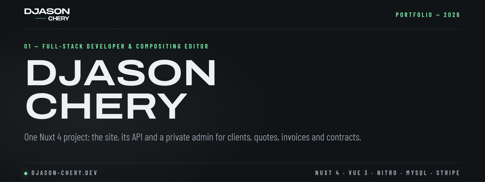

<p align="center">
  
</p>

<p align="center">
  <a href="https://djason-chery.dev"></a>
  <a href="https://www.linkedin.com/in/djason-chery-3b87702b4"></a>
  <a href="https://www.malt.fr/profile/djasonchery"></a>
  <a href="mailto:contact@djason-chery.dev"></a>
  <a href="https://wa.me/33758204726"></a>
  <a href="https://www.instagram.com/djasonchery"></a>
</p>

<p align="center">
  <a href="#01--whats-inside"><b>01 — INSIDE</b></a> &nbsp;·&nbsp;
  <a href="#02--quick-start"><b>02 — QUICK START</b></a> &nbsp;·&nbsp;
  <a href="docs/en/README.md"><b>03 — DOCUMENTATION</b></a> &nbsp;·&nbsp;
  <a href="docs/fr/README.md"><b>DOCUMENTATION FR</b></a> &nbsp;·&nbsp;
  <a href="https://djason-chery.dev"><b>LIVE SITE</b></a>
</p>

---

My portfolio as a **full-stack developer** and **compositing editor**: [djason-chery.dev](https://djason-chery.dev).

One **Nuxt 4** project holds both the site and its API (Nitro), organized like a
[DC Scaffold](https://github.com/Djason16/dc-scaffold) project. Besides the public pages, a private admin space
manages clients, missions, projects, skills and availability, makes quotes, invoices and contracts as PDF, and takes payments with Stripe.

## 01 — What's inside

| Code | Part | Highlights |
| ---- | ---- | ---------- |
| `SI-01` | **Site** | Server-side rendering, French / English, SEO (sitemap, robots, meta tags), one scroll animation per section, cookie banner, online withdrawal |
| `AD-02` | **Admin** | Email + one-time code login, tools grouped by task, clients, missions, projects, skills, calendar, every text of the site and of the documents |
| `DO-03` | **Documents** | Quotes, invoices and contracts stored, numbered in your own format (prefix, year / month, figures, go on from a number), payments, legal interest rates, PDF with real text in the ink of the site |
| `TR-04` | **Translation** | The French typed in the admin fills the English (MyMemory, free, no key) |
| `AP-05` | **API** | Automatic REST routes from controllers, same JSON format everywhere, MySQL database (phpMyAdmin) |
| `PA-06` | **Payments** | Stripe Checkout and subscriptions |

**Stack:** Nuxt 4.4 · Vue 3.5 · Nitro · Pinia 3 · MySQL · Stripe 22 · Nodemailer 9 · Font Awesome 7

## 02 — Quick start

Requires **Node.js 22.16+** (24 LTS recommended) and **Docker Desktop** (local MySQL database).

**Windows:** double-click `start.bat`, then press `D`. The site opens on http://localhost:3000, phpMyAdmin on http://localhost:8081.

**Mac / Linux:**

```bash
git clone https://github.com/Djason16/djason-cv.git
cd djason-cv/frontend
cp .env.example .env   # then fill in your values
docker compose --project-directory .. --env-file .env up -d   # MySQL + phpMyAdmin
npm install
npm run dev
```

The site is on http://localhost:3000 and the API on http://localhost:3000/api.

## 03 — Documentation

Everything else is in **[`docs/`](docs/en/README.md)** (🇫🇷 [version française](docs/fr/README.md)):

| Code | Page | What you'll find |
| ---- | ---- | ---------------- |
| `DOC-01` | [Getting started](docs/en/01-getting-started.md) | Requirements, `start.bat`, npm scripts |
| `DOC-02` | [Configuration](docs/en/02-configuration.md) | Every `.env` variable, in the order of the file |
| `DOC-03` | [Architecture](docs/en/03-architecture.md) | Folders, tech stack, conventions |
| `DOC-04` | [The site](docs/en/04-site.md) | Texts and languages, skills, cookies, styles, adding a page |
| `DOC-05` | [The API](docs/en/05-api.md) | Response format, adding a route, database, every route |
| `DOC-06` | [Admin & documents](docs/en/06-admin-documents.md) | The dashboard, projects and skills, translation, quotes, invoices and contracts |
| `DOC-07` | [Security](docs/en/07-security.md) | Sessions, rate limits, uploads |
| `DOC-08` | [Deployment](docs/en/08-deployment.md) | Build and put the site online (Infomaniak) |
| `DOC-09` | [Troubleshooting](docs/en/09-troubleshooting.md) | Common problems and their fix |

## 04 — Contact

📩 [contact@djason-chery.dev](mailto:contact@djason-chery.dev) · 📞 [07 58 20 47 26](tel:+33758204726) · 🌐 [djason-chery.dev](https://djason-chery.dev)

## 05 — License

MIT, see [LICENSE](LICENSE).

---

<p align="center"><sub>● &nbsp;DJASON CHERY EI &nbsp;·&nbsp; FULL-STACK & COMPOSITING &nbsp;·&nbsp; <a href="https://djason-chery.dev">DJASON-CHERY.DEV</a></sub></p>
