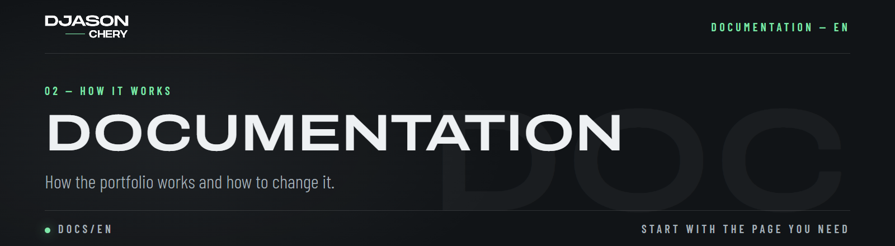

# 00 — Documentation

🇫🇷 [Version française](../fr/README.md)

How the portfolio works and how to change it. No need to read everything: start with the page you need.

| Code | Page | What you'll find |
| ---- | ---- | ---------------- |
| `DOC-01` | [Getting started](01-getting-started.md) | Requirements, `start.bat`, npm scripts |
| `DOC-02` | [Configuration](02-configuration.md) | Every `.env` variable, development and production |
| `DOC-03` | [Architecture](03-architecture.md) | Folders, tech stack, conventions |
| `DOC-04` | [The site](04-site.md) | Texts and languages, cookies, styles, the app shell, adding a page |
| `DOC-05` | [The API](05-api.md) | Response format, adding a route, database, every route |
| `DOC-06` | [Admin & documents](06-admin-documents.md) | The dashboard, projects and skills, machine translation, quotes, invoices and contracts |
| `DOC-07` | [Security](07-security.md) | Sessions, rate limits, uploads |
| `DOC-08` | [Deployment](08-deployment.md) | Build and put the site online (Infomaniak) |
| `DOC-09` | [Troubleshooting](09-troubleshooting.md) | Common problems and their fix |

All paths below are relative to `app/`, unless they start with the project root (`start.bat`, `docs/`...).
