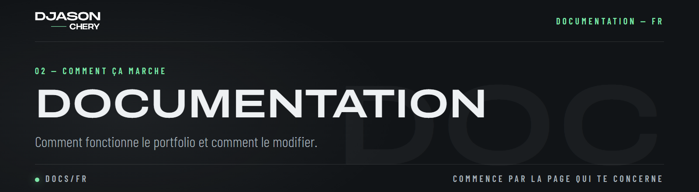

# 06 — L'admin et les documents

**DOC-06** &nbsp;·&nbsp; [← Documentation](README.md)

La page admin crée des **devis** et **factures** (enregistrés, avec leurs paiements) et des **contrats** (créés depuis un devis finalisé). Ses outils sont rangés sur un tableau de bord.

## 01 — Le tableau de bord (admin)

Du plus utile au moins utile :
1. **À faire** (`AdminTodo.vue`, calcul `utils/billingTodo.ts`) : quatre colonnes dans l'ordre du travail, *À finaliser* (brouillons), *À faire signer* (devis sans contrat ou pas signés), *À encaisser* (paiement attendu, avec le montant total), *À facturer* (missions pas encore facturées, une ligne par client). Un clic ouvre le document à son étape, ou la facture du client avec ses missions déjà cochées. Dessous, l'état de ce que le serveur fait seul (dernier passage, e-mails envoyés) et *Lancer maintenant*.
2. **Quatre boutons** : *Nouveau devis*, *Nouvelle facture*, *Nouvelle mission*, *Nouveau client*.
3. **Les cartes** : **Travail** (devis & factures, clients, missions) et **Site & disponibilités** (projets, compétences, textes, calendrier, indisponibilités, dispo. forcée).
4. **Réglages**, repliés (*Afficher les réglages*) : mes infos, numérotation, taux, mot de passe, environnement.

- Une liste ouvre son propre formulaire : *Créer client* dans Clients, *Créer mission* dans Missions, *Ajouter un projet* / le crayon d'une ligne dans Projets. Fermer le formulaire ramène la liste (le flou derrière reste jusqu'à la fermeture de la dernière modale).
- Tableaux : clic sur une valeur avec un crayon, Entrée ou le bouton vert enregistre. Clients, missions et projets sont en pages (autant de lignes que l'écran en tient, sans barre de défilement) ; la flèche d'une ligne ouvre ses autres valeurs (colonnes `detail: true` d'`EditableTable`, pages : `per-page`, `TablePager.vue`). Sur téléphone chaque ligne est une fiche compacte (sa première valeur en titre, les autres deux par deux).
- Formulaires : côte à côte sur ordinateur (`FormModal`, prop `columns`), les boutons toujours visibles.
- Traduction automatique : dans Projets et Compétences le texte français remplit l'anglais un instant après la saisie ; dans Textes du site un texte français enregistré remplit l'anglais jamais modifié à la main (`composables/useAutoTranslate.ts`, MyMemory). Toujours relire.

| Partie | Où |
| ------ | -- |
| Cartes, boutons, groupes | `components/views/Admin/Admin.vue` (`TOOLS`, `QUICK`, `GROUPS` ; textes `adminGroup*`, `adminHint_*`, `adminTodo*` dans `plugins/translations/pages/admin/dashboard.ts`) ; `AdminTodo.vue` (style `admin-todo.css`) |
| Projets | `ProjectListModal.vue` (lignes compactes), `CreateProjectModal.vue` (nouveau et modification), `components/ui/Form/TagPicker.vue` (compétences) |
| Compétences | `SkillsModal.vue`, `composables/useSkills.ts`, `server/controllers/SkillsController.ts` |

## 02 — Devis & factures (admin → Devis & factures)

Comme un logiciel de facturation : chaque devis et facture est **enregistré** (table `dc_documents`, paiements dans `dc_payments`), avec son état et son historique.

1. **Nouveau devis / Nouvelle facture** : un brouillon. À gauche le formulaire (client, objet, dates, lignes, remise, paiement, notes), à droite le document lui-même, mis à jour à chaque changement.
   *Importer des missions* : coche les missions du client à mettre sur le document.
   **Paiement par carte par défaut** (lien de paiement : payé, enregistré et facturé tout seul) ; *Proposer aussi le virement bancaire* imprime ton IBAN sur ce document (et sur son contrat et ses factures).
   Ce qui attend est sur le tableau de bord (*À faire*). Un contrat ou une facture d'un devis a un bouton *Suivi du devis* pour y revenir.
2. **Paiement** d'un devis : en une fois, **acompte + solde** (en % ou en montant), un **échéancier libre** (autant d'échéances que voulu, chacune en % ou en montant, la dernière prend le reste) ou des **mensualités** (nombre de mois, première date).
3. **Finaliser** : le document reçoit le numéro suivant de sa suite (proposé, toujours modifiable), une copie du client, et ne peut plus être modifié (dupliquez-le pour en faire un nouveau).
4. **Suivi d'un devis** (`BillingFlow.vue`), toujours dans cet ordre : le devis, son contrat (créé et finalisé depuis lui en un clic, ou *Sans contrat* : conseillé pour un paiement en plusieurs fois ou dès 1 500 €, sinon le devis signé avec les CGV suffit ; *Ajouter un contrat finalement* jusqu'à la signature), les deux envoyés au client par e-mail en un clic (les deux PDF joints) ou téléchargés, puis signés par le client, puis les paiements : une facture n'est créée qu'à l'arrivée d'un paiement (par carte toute seule ; autrement avec *Paiement reçu* : date, montant, moyen) ; chaque étape faite est cochée, seule l'étape en cours montre ses boutons. Devis et contrats impriment sous la signature l'acceptation des CGV et, pour un particulier, la demande de démarrage avant la fin des 14 jours de rétractation.
5. Un devis finalisé : *accepté* / *refusé*, puis **une facture par échéance** (facture d'acompte, factures d'échéance, facture de solde : le solde déduit ce qui a déjà été facturé).
6. Une facture : les **paiements reçus** (date, montant, moyen) ; payée, payée en partie, en retard et reste à payer se calculent seuls.
7. **Par e-mail** (`composables/useDocumentMail.ts` → `POST /api/documents/{id}/send`, `server/helpers/DocumentMailHelper.ts`, modèles `server/templates/DocumentMails.ts`) : *Envoyer par e-mail* sur tout document finalisé, le PDF en pièce jointe, une copie pour toi, la date d'envoi notée. Le PDF est fabriqué par le navigateur de l'admin (le même que le téléchargement), le serveur l'envoie. Après un paiement :
   - enregistré dans l'admin (*Paiement reçu*, *Enregistrer le paiement*) : le client reçoit tout de suite *Paiement reçu* avec la facture jointe ;
   - en ligne (Stripe, prélèvement) : le client reçoit tout de suite *Paiement reçu* avec le bouton *Télécharger ma facture* (`/pay-me/?doc=<lien de la facture>&pdf=1` : le même PDF, fabriqué dans son navigateur, `GET /api/stripe/document-file`), toi *Nouveau paiement*. Un seul moteur de PDF : celui du navigateur (le serveur n'en dessine pas) ; un envoi raté est refait par la tâche automatique (`options.mailPending`).
8. **Tout seul** (`server/plugins/billing-tasks.ts` → `BillingTasksHelper` : 90 s après le démarrage puis toutes les 30 minutes ; *Lancer maintenant* : `POST /api/documents/tasks`, dernier passage : `GET /api/documents/tasks`, gardé dans `dc_settings.billingTasksLastRun`) :
   - les factures pas encore parties sont renvoyées ;
   - une fois par jour à partir de 9 h, dans le **fuseau de l'agenda** (admin → Calendrier ; `TimeZoneHelper`, `utils/display.ts` `todayIso` : il fixe aussi la date des documents), les relances de `ReminderHelper` (modèles `ReminderMails.ts`), chacune une seule fois (`options.reminders`) : facture impayée le jour de son échéance puis 7 jours après ; prochaine échéance d'un devis signé 3 jours avant, le jour même puis 7 jours après (pas avec le prélèvement automatique, qui a ses propres e-mails) ; devis bientôt expiré (3 jours avant la fin) au client ; devis envoyé et pas signé après 7 jours, pour toi.
   En ligne, l'application doit tourner en continu (elle ne s'endort pas chez Infomaniak).
9. **PDF** à tout moment, téléchargé tout de suite (sans fenêtre d'impression) : la feuille de l'aperçu dessinée dans un PDF A4, du vrai texte sélectionnable, dans les polices du site, à l'encre du site, avec les mentions françaises (pénalités de retard, indemnité de 40 € pour les pros, TVA non applicable quand aucune ligne n'a de TVA).

| Partie | Où |
| ------ | -- |
| Écrans | `components/views/Admin/Billing/` (`BillingModal` : liste ou éditeur ; `BillingList`, `BillingEditor`, `EditorLines`, `EditorPlan`, `BillingActions`) |
| Données | `stores/billing.ts` (+ `stores/actions/billingActions.ts`) → `/api/documents` |
| Montants (partagés par le navigateur et le serveur) | `utils/billing.ts` : totaux, remise, TVA par taux, échéances, payé / reste à payer |
| Serveur | `server/controllers/DocumentsController.ts`, `server/helpers/DocumentsHelper.ts` (numéros, factures depuis un devis) |
| Document et PDF | `components/views/Documents/BillingDocument.vue` (style `billing-document.css`) ; `utils/pdf.ts` (met la feuille en page), `utils/pdfRender.ts` (la dessine avec jsPDF : pages, fonds, mots, liens), `utils/pdfFonts.ts` (polices de `public/fonts/`) |

## 03 — Missions (admin → Missions)

Une mission est un travail à facturer, pour n'importe quel client : du temps passé (taux horaire × durée × quantité) ou un forfait, avec un titre et une description facultative. Pour en facturer, ouvre une nouvelle facture pour le client → *Importer des missions* : les missions pas encore facturées s'affichent, coche celles à regrouper (*Tout cocher* pour toutes ; le total coché s'affiche). Chaque ligne de la facture porte sous son titre la date de la mission en toutes lettres, puis sa description. Une fois la facture finalisée, ses missions affichent *FA-… ✓* et ne peuvent plus être facturées ni modifiées ; une facture annulée les rend. Un projet avec devis (site, vidéo…) n'a pas besoin de missions.

| Partie | Où |
| ------ | -- |
| Écrans | `CreateMissionModal.vue`, `MissionListModal.vue` (colonne *Facture*), `Billing/EditorLines.vue` (missions à cocher) |
| Serveur | `server/controllers/MissionsController.ts` ; `dc_missions.invoice_id` posé par `DocumentsHelper.finalize` (lignes avec `missionId`), vidé quand la facture est annulée |

## 04 — Paiement en ligne (lien de paiement)

Un devis finalisé ou une facture avec un reste à payer a un **lien de paiement** (*Paiement en ligne → Créer le lien de paiement*, copié tout de suite, aussi imprimé sur son PDF) :
`/pay-me/?doc=<secret>`. La page Payez-moi montre alors le document et le montant, que le client ne peut pas changer, puis ouvre Stripe.

- **Facture** : le client paie le reste ; le paiement (mode *Stripe*) s'ajoute à la facture.
- **Devis** : le client paie l'étape suivante (acompte, échéance ou le total). La facture de cette étape est créée (ou celle déjà faite est reprise), numérotée, et reçoit le paiement ; le devis passe en *accepté*. Si cette facture ne peut pas être créée, le paiement reste sur le devis (voir les logs du serveur).
- Le montant vient toujours du document (côté serveur) ; une session n'est enregistrée qu'une fois.
- **Prélèvement automatique** (un devis en plusieurs étapes datées : mensuel, échéancier) : la page montre chaque étape ; le client peut cocher le prélèvement automatique en payant la première (son accord, aussi affiché par Stripe). Stripe garde la carte ; `server/plugins/autopay.ts` (une minute après le démarrage, puis toutes les 6 heures) débite chaque étape suivante à sa date avec `AutopayHelper`, crée et règle sa facture, Stripe envoie le reçu. Carte refusée : un e-mail au client (avec un bouton pour payer à la main) et un à toi ; le prélèvement reste actif. L'admin l'affiche (*Paiement en ligne*) et peut l'arrêter.
- **Apparence** : les pages Stripe reprennent l'encre, le bouton menthe et les coins droits du site (`branding_settings`, `StripeHelper.ts` ; le logo seulement une fois en ligne) ; les pages de retour (`server/templates/StripePages.ts`) et tous les e-mails (`server/templates/MailLayout.ts`) suivent aussi le site.
- Enregistré quand le client ferme la fenêtre Stripe, et par le **webhook** `POST /api/stripe/webhook` (événement `checkout.session.completed`), qui marche même si le client ferme la page trop tôt. En local : `stripe listen --forward-to localhost:3000/api/stripe/webhook` ; en ligne : Dashboard Stripe → Développeurs → Webhooks, avec l'adresse du site. Son secret va dans `STRIPE_WEBHOOK_SECRET`.

| Partie | Où |
| ------ | -- |
| Liens, résumé, enregistrement | `server/helpers/PayLinkHelper.ts` (colonne `pay_token` de `dc_documents`) |
| Prélèvement automatique | `server/helpers/AutopayHelper.ts`, `server/plugins/autopay.ts`, `server/templates/AutopayMails.ts` (`options.autopay` du devis) |
| Stripe | `server/controllers/StripeController.ts` (`document`, `createCheckout` avec un token, `checkPayment`, `webhook`), `server/helpers/StripeHelper.ts` |
| Page | `components/views/PayMe/PayDocument.vue` (affichée par `PayMe.vue` avec `?doc=`), `PaySchedule.vue` (les étapes) |
| Admin | `components/views/Admin/Billing/BillingActions.vue` (*Paiement en ligne*) |

## 05 — Numérotation (admin → Numérotation)

Pour chaque type (devis, factures, contrats) : un **préfixe** (`DE`, `D`, `DEV`... n'importe quelles lettres), un **format** et les **chiffres** du compteur, avec le prochain numéro affiché en direct.

| Format | Exemple | Le compteur repart à 1 |
| ------ | ------- | ---------------------- |
| `{P}-{YYYY}-{N}` (par défaut) | `DE-2026-0001` | chaque année |
| `{P}{YYYY}-{N}`, `{P}{YYYY}{N}`, `{P}-{YY}-{N}` | `DE2026-0001`, `DE20260001`, `DE-26-0001` | chaque année |
| `{P}-{YYYY}{MM}-{N}`, `{P}{YY}{MM}{N}` | `DE-202611-0001`, `DE26110001` | chaque mois |
| `{P}-{N}`, `{P}{N}` | `DE-0001` | jamais |

Un format personnalisé marche aussi (`{P}` préfixe, `{YYYY}` / `{YY}` année, `{MM}` mois, `{N}` compteur).
**Reprendre à** : tape le prochain numéro voulu (`CO-2026-0007`) : il est utilisé s'il vient après le dernier numéro déjà donné dans cette suite.
Les factures doivent rester continues et chronologiques : change de format de préférence au 1er janvier.

| Partie | Où |
| ------ | -- |
| Règles (communes au navigateur et au serveur) | `utils/numbering.ts` (`nextNumber`, `numberingOf`, `NUMBER_FORMATS`) |
| Écran | `components/views/Admin/NumberingModal.vue` |
| Stockage | `dc_settings`, clé `numbering` (JSON), lue par `server/helpers/DocumentsHelper.ts` à la finalisation |

## 06 — Contrats (admin → Devis & factures → Contrats)

Un contrat se crée depuis un devis finalisé (*Créer le contrat*, avec le type de prestation : web, vidéo ou réparation) : il reprend son client,
ses montants et ses échéances, reçoit son numéro une fois finalisé (`CO-2026-0001`) et se marque *signé* quand le client l'a signé.
Ses articles sont dans `components/views/Documents/ContractContainer/` (style `contract-container.css`, la même feuille que les factures) ;
`utils/contractDocument.ts` transforme le contrat enregistré en props du modèle.

**Taux d'intérêt** : devis, factures et contrats utilisent le taux légal de leur date d'émission pour le type de client (admin → Taux,
un taux par semestre, professionnel et particulier). L'éditeur l'affiche et prévient quand le taux du semestre manque ;
le PDF imprime les pénalités (trois fois le taux légal). Le taux reste attaché au document une fois finalisé.

## 07 — Modifier un modèle

Modifie librement les composants de `components/views/Documents/`, mais **garde leurs classes CSS** :
les sauts de page du PDF en dépendent.
Leurs **textes** (libellés, mentions, articles des contrats) se changent sans code dans admin → Textes du site → *Documents : devis et factures* / *Documents : contrats* (fichiers `plugins/translations/pages/admin/billingDocument.ts` et `contracts.ts`).

---

<a href="05-l-api.md">← 05 — L'API</a> &nbsp;·&nbsp; <a href="README.md">Documentation</a> &nbsp;·&nbsp; <a href="07-securite.md">07 — Sécurité →</a>

